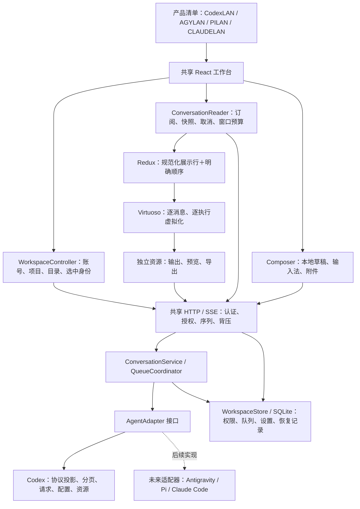

# 当前架构

React 是唯一浏览器入口。旧的 `public/`、DOM 总控、共享浏览器 reducer 和过渡读取适配器均已删除。源码中的服务端只装配新链路；运行中的独立安装版本与源码检出是不同目录。

## 职责与入口

| 位置 | 职责 |
| --- | --- |
| `web/src/app/App.tsx` | 装配工作台、身份缓存及根级预览弹窗 |
| `app/controllers/WorkspaceController.ts` | 目录与后台摘要；更新标题、状态时保持选中对象身份 |
| `app/controllers/ConversationReader.ts` | 唯一的选中会话订阅；取消过期读取、恢复、历史窗口预算 |
| `features/conversation/model/` | 只接收已确定位置的展示行；没有网络和原生协议 |
| `features/conversation/ui/` | 按 ID 订阅；执行条目与轮次小结分别虚拟化 |
| `features/composer/` | 组件本地草稿；按明确动作发送，不测量每次按键的布局 |
| `features/details/`、`features/content/` | 分段输出、ANSI、标准 Markdown/数学、按需图表和沙箱文件预览 |
| `web/src/transport/` | 版本化 LAN DTO、HTTP、CSRF、SSE epoch/sequence 与重连 |
| `shared/` | 产品、能力、配置描述、展示、命令、工作区的 TypeScript 合约 |
| `server/core/` | 授权路由、共享队列策略、回答递送、SSE 过滤与背压 |
| `server/agents/adapter-contract.ts` | 真实服务端适配器接口；拒绝与接收结果不确定的错误语义 |
| `server/agents/codex/` | Codex 原生协议、历史位置、投影、模型/Goal/审批、输出资源 |
| `server/codex-client.mjs`、`browser-access.mjs` | 保留的独立进程连接与浏览器签名基础设施 |
| `server/workspace-store.mjs`、`workspace-database.mjs` | 既有业务数据和 SQLite v14；不依赖浏览器文件 |
| `server/static.mjs`、`dist/web/` | React 静态发行文件；不存在旧页面回退 |
| `products/` | 产品标识和默认提供者；不复制工作台 |

## 顺序、并发与恢复

原生历史的轮次和条目顺序是权威来源。状态、完成时间、接收时间和条目类型都不能制造位置。分页先确定轮次，再取轮次内条目，保留没有消息的失败/停止轮次。游标绑定会话，过期返回 409，允许显式重新同步。

Codex 原生事件先同步维护 ID 索引、乐观输入别名及终态，再合并为展示更新。文本 delta 只更新自己的行；迟到的历史完成事件没有追加权限。SSE 在读取快照之前订阅，使用连接 epoch 和递增序列；展示行 revision 防止缓冲的旧事件覆盖较新的快照。网络序列与投影版本分别拥有含义。

切换会话释放旧实体与控制状态。目录/标题更新不重连历史。重连保留已加载的较早窗口；无法建立重叠位置时保留阅读位置，提示点击“最新记录”。显式窗口切换可以重置视口，不会清理草稿。

队列归应用层所有。先持久化提交中，再请求适配器，明确接收后才按输入 ID 出队。断线或超时不能自动重放；重启期间未确认的提交标为结果不确定。适配器负责将提供者错误翻译为明确拒绝、结果不确定及 inactive-run，应用层不解释 Codex 错误字符串。异步问题只有在明确的任务已结束拒绝后才允许改为排队。

## 工作量与资源边界

- 默认历史每次 100 展示行，最多 200 行、约 128 KB；消息预览最多 12,000 字符。工具正文不进入行实体。
- 选中会话保留最多 1,500 行、约 2 MB 的展示内容预算。达到边界保留当前窗口；继续读取较早内容是明确的换页操作。
- Virtuoso 只挂载视口附近的消息/执行，不以巨大轮次为一个虚拟项。
- Markdown 使用 react-markdown、remark-gfm；数学使用 remark-math/rehype-katex。树节点、深度、公式数量和展开规模均有边界。流式消息显示有界纯文本，完成后再富文本化。
- Mermaid 只在点击预览后加载；源码最多 4,000 字符、200 边；预览归根组件所有，虚拟行卸载不会关闭它。
- 工具展开时读取独立资源，每段最多 16,000 字符；运行输出显示有界末尾，最多每 500 ms 刷新展开项。折叠项不读正文。
- 原生接口只提供完整条目时，一次读取写入临时资源文件，再分页读取；不会为每段重复读取完整原生正文。资源缓存最多 32 项/128 MB，按年龄和使用情况回收，服务关闭时清理。单项超限明确报错。
- 浏览器输出缓存最多 32 个分段；翻页替换正文。完整 Markdown 走服务端流式下载；复制/打印/原生分享最多读取 256,000 字符，超限引导下载。
- 恢复副本在独立小结资源中标明“原始位置未知”，不插入时间线冒充原始记录。
- 文件预览执行项目真实路径检查，文本/HTML 最多 200 KB；HTML/SVG 处于没有脚本权限的沙箱。原文件下载直接传输，不先生成巨大的浏览器 Blob。
- 所有持续订阅均检查账号/项目权限、会话过期和写缓冲。权限变更关闭订阅，重连重建可见项目列表。

## 构建与运行

Vite 仅负责 TSX、依赖和静态资源构建；Node 仍只需要 Express 及其生产依赖，不增加前端生产服务。源码开发可用 HMR，也可用 `web:watch` 保存后自动构建。生产只发布 `dist/web/`，开发验收入口不进入产品构建。HTML 重新验证，带内容标识的资源使用长期缓存；watch 构建保留先前资源以供已打开页面加载。

数据库账号、项目授权、绑定、队列身份/顺序/递送状态、设置及恢复数据继续使用原有业务存储。旧实现的删除范围是代码与过时测试，不包括用户数据、备份或独立安装的回滚版本。

## 多产品边界

现在可运行的是 Codex 适配器，`products/` 中只有 CodexLAN 产品清单；其他三个产品是后续目标。新增代理实现服务端接口、真实能力和命名空间配置描述即可复用 UI、权限、队列、事件封装与资源组件。现有 Codex 会话保持原 UUID，保障原数据兼容；增加非 UUID 原生代理时，适配器需要持久化原生 ID 与 LAN UUID 的映射，并扩充当前绑定存储，不能把其他提供者 ID 塞进 Codex 命名空间。
